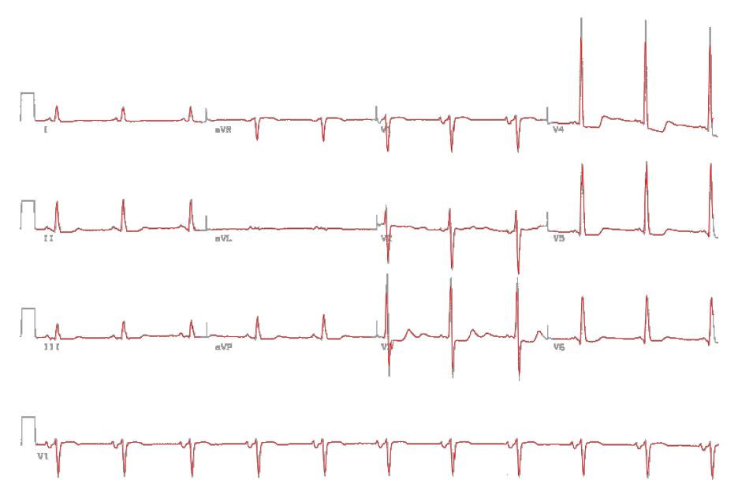

# Pembaca EKG 12 Sadapan: Machine Learning, Deep Learning & Pengukuran Otomatis

Sistem interpretasi EKG 12 sadapan berbasis dataset **PTB-XL**: perbandingan *machine learning* klasik vs *deep learning* (1D ResNet), model multi-tugas 58 label (5 superclass + 53 kode SCP-ECG), pengukuran berbasis aturan, laporan 8 kategori, aplikasi web, uji eksternal, dan digitalisasi EKG dari gambar.

Proyek pendamping makalah *"Pemanfaatan Machine Learning, Deep Learning, dan Large Language Model dalam Interpretasi Elektrokardiogram (EKG)"* — Muhammad Affan Hassya Purnomo, FK UNS. Makalah lengkap (BAB IV membahas implementasi ini): [`docs/makalah_ai_ekg.pdf`](docs/makalah_ai_ekg.pdf).

> Model ini untuk pembelajaran, **bukan** alat diagnosis klinis.

## Cara cepat: satu perintah

```bash
python3 main.py
```

Saat pertama dijalankan, `main.py` otomatis membuat virtualenv `.venv` dan memasang dependensi (±1–3 menit, sekali saja). Setelah itu:

1. model dimuat dan diuji cepat pada 5 file di `contoh/`,
2. web aktif di **http://localhost:8000** dan browser terbuka otomatis,
3. prediksi di web dijalankan oleh **PyTorch di server lokal** (±0,2 detik untuk rekaman 5 menit). Baris info hasil menulis `mesin: PyTorch · server lokal`.

Opsi lain:

```bash
python3 main.py file.csv --fs 257          # prediksi satu file langsung di terminal
python3 main.py --port 9000 --no-browser   # port lain, tanpa membuka browser
python3 main.py -v --log-file logs/server.log   # log rinci + simpan ke file
curl --data-binary @file.csv "http://localhost:8000/api/predict?fs=257"   # API JSON
```

Tekan `Ctrl+C` untuk menghentikan server; ringkasan sesi (jumlah permintaan, median latensi, memori puncak) tercetak saat berhenti.

**Log terminal.** Setiap prediksi tercatat satu baris: nama file, frekuensi, durasi, jumlah jendela, ukuran data, rincian waktu (baca · parse · pra-proses · inferensi · total) dan kesimpulan. `-v` menambahkan probabilitas tiap kelas dan permintaan file statis.

```
13:23:15 INFO  PREDIKSI I03_MI-akut_ST-elevasi-PVCs_257Hz.csv | 257→100 Hz (diubah di browser), 300.0 s, 30 jendela, 2542 KB | baca 1 · parse 52 · pra-proses 6 · inferensi 65 · total 123 ms (2438× realtime) | Abnormal: Infark miokard (92%), …
```

**Statistik performa di web.** Panel *Performa* menampilkan total waktu, waktu inferensi, waktu per jendela 10 detik, kecepatan (× realtime), pembagian waktu per tahap (baca CSV, resampling, kirim data, pra-proses, inferensi, gambar EKG), riwayat sesi, median/p95, dan info sistem server (`GET /api/stats`).

## Cakupan diagnosis (8 kategori)

Setiap EKG menghasilkan **laporan 8 kategori** (di web, terminal, dan API) yang menggabungkan dua sumber:

- **Model** (`model/resnet1d_full.pt`): 1D ResNet multi-tugas yang mengeluarkan 5 superclass + **53 kode SCP-ECG** PTB-XL (semua kode dengan ≥ 50 contoh). Macro AUC uji: superclass 0,926, kode rinci 0,920. Ambang per kode = F1 maksimum di set validasi, minimal 0,10.
- **Pengukuran berbasis aturan** (`src/measure.py`, versi JS di `web/`): frekuensi jantung, irama, PR, QRS, QT/QTc, aksis, voltase, deviasi ST, PVC/PAC, kualitas sinyal, plus heuristik untuk pola yang **tidak ada di PTB-XL** (VF, asistol, takikardia kompleks lebar, blok AV derajat 2/3, flutter, irama junctional/idioventrikular).

| Kategori | Dari model (AUC uji) | Dari pengukuran / heuristik | Belum didukung |
|---|---|---|---|
| 1. Interpretasi umum | EKG normal (0.95) | tidak dapat dibaca (sadapan datar/bising) | — |
| 2. Irama sinus | irama sinus (0.88), bradikardia (0.96), takikardia (0.99), sinus aritmia (0.83) | frekuensi < 60 / > 100 | — |
| 3. Atrium | PAC (0.93), fibrilasi atrium (0.98), aritmia supraventrikular (0.92) | AF (RR tidak teratur tanpa P), flutter (aktivitas atrium 250–400/menit) | MAT spesifik |
| 4. Junctional | — | irama junctional/escape, SVT/AVNRT | PJC |
| 5. Blok AV | blok AV 1 (0.97) | PR > 220 ms; P lebih banyak dari QRS (derajat 2/3) | pembedaan Mobitz I vs II |
| 6. Ventrikel | PVC (0.99), bigemini (0.95) | VF, asistol, takikardia kompleks lebar, run ≥ 3 denyut ektopik, AIVR | Torsades de Pointes |
| 7. Konduksi & aksis | RBBB (1.00), LBBB (1.00), LAFB (0.98), LPFB (0.91), WPW (0.81) | aksis < −30° / > +90° | — |
| 8. Iskemia/infark/hipertrofi/QT | MI inferior (0.92), anteroseptal (0.97), iskemia (0.96), LVH (0.94), pembesaran atrium, QT panjang (0.85) | elevasi ST ≥ 2 sadapan bersebelahan, QTc > 490 / < 340 ms | — |

**Validasi pengukuran** (2.158 EKG uji PTB-XL, dibandingkan label kardiolog): sinus takikardia sensitivitas 0,94/PPV 0,75; fibrilasi atrium 0,58/0,92; aksis kiri vs LAFB 0,80/0,58. Median EKG normal: PR 180, QRS 90, QTc 397 ms. VF terdeteksi 3/3 segmen CU Ventricular Tachyarrhythmia DB tanpa positif palsu di PTB-XL; asistol terdeteksi pada sinyal datar.

**Keterbatasan yang diketahui:**
- Heuristik VT gagal pada run VT di data Holter INCART (I30) karena lebar QRS terukur terlalu sempit. Jangan andalkan kategori 6 untuk VT.
- Kode jarang (QT panjang, efek elektrolit, voltase tinggi) hampir tidak pernah positif setelah ambang minimum 0,10. Jadi QT panjang praktis hanya terdeteksi dari pengukuran QTc.
- Interval diukur pada 100 Hz (resolusi 10 ms) dari median beat. Hasilnya perkiraan, tidak setara pembacaan manual.
- PPV pengukuran ST/T, PVC, dan voltase LVH rendah dibanding label kardiolog. Karena itu temuan tersebut di laporan diambil dari model, bukan dari aturan.

## Uji eksternal

**INCART (Holter 12 sadapan, 18 pasien, 5 menit pertama, 257 Hz)**. Data tidak disertakan di repo; unduh dari [PhysioNet](https://physionet.org/content/incartdb/1.0.0/).

| Kondisi menurut sumber | Rekaman | Terdeteksi oleh laporan |
|---|---|---|
| Infark miokard akut | I03, I62, I64 | 3/3 sebagai infark; elevasi ST 2/2 (I03, I62) |
| Hipertrofi ventrikel kiri | I20, I44, I72 | 3/3 |
| RBBB | I16 | 1/1 |
| Fibrilasi atrium | I50 | 1/1 |
| WPW | I68, I71 | 1/2 |
| Blok AV derajat 2 Mobitz I | I09 | 0/1 (dibaca fibrilasi atrium) |

"Hipertrofi ventrikel" juga muncul pada 7 dari 15 rekaman tanpa LVH. Penyebab yang mungkin adalah *domain shift* dari elektroda Holter (Mason–Likar) dibanding EKG istirahat PTB-XL.

**VF (CU Ventricular Tachyarrhythmia DB):** 3/3 segmen VF terdeteksi, dan tidak ada positif palsu pada 2.158 EKG uji PTB-XL. Daya 3–8 Hz pada VF 0,79–0,91, sedangkan pada PTB-XL maksimal 0,62.

## Digitalisasi EKG dari gambar

`tools/digitize.py` mengubah gambar EKG cetak (format 3×4 + strip ritme) menjadi sinyal, dan `tools/build_csv.py` menyusunnya menjadi CSV. Contoh: EKG *"Left ventricular and left atrial hypertrophy"* dari [ECG Library](http://www.ecglibrary.com/lvhlah.html) (pria 83 tahun, stenosis aorta).

1. Skala dibaca dari pulsa kalibrasi: 1 mV = 31 px; 0,2 s = 15 px → 25 mm/s.
2. Jejak tiap baris ditelusuri per kolom piksel dari garis dasarnya; garis pemisah antar-kolom dibuang.
3. Karena tiap sadapan hanya tercetak 2,5 s, sisa 10 s diisi median beat sadapan itu pada waktu detak dari strip ritme V1.



Hasil (`contoh/digitasi/lvhlah_12sadapan_10s_100Hz.csv`): irama sinus 63/menit, **LVH p = 0,61** (sesuai sumber), plus perubahan ST non-spesifik. Pembesaran atrium kiri dari sumber **tidak** terdeteksi; kemungkinan karena resolusi gambar rendah (±3 px/mm).

```bash
python tools/digitize.py gambar.gif rows.npy
python tools/build_csv.py rows.npy mentah.csv siap_model.csv
python3 main.py siap_model.csv
```

Konstanta skala, garis dasar, dan posisi kolom di `digitize.py` disetel untuk gambar contoh; gambar lain perlu penyesuaian.

## Hasil model 5 kelas (data uji, fold 10, n = 2.158 EKG)

| Kelas | Arti | AUC ML klasik | AUC CNN | Sensitivitas CNN | Spesifisitas CNN | PPV CNN |
|---|---|---|---|---|---|---|
| NORM | EKG normal | 0,913 | **0,948** | 92% | 83% | 81% |
| MI | Infark miokard | 0,859 | **0,929** | 87% | 83% | 64% |
| STTC | Perubahan ST/T | 0,906 | **0,939** | 88% | 84% | 64% |
| CD | Gangguan konduksi | 0,872 | **0,921** | 83% | 87% | 65% |
| HYP | Hipertrofi | 0,887 | **0,900** | 81% | 82% | 39% |
| **Macro** | | **0,887** | **0,927** | | | |

Sensitivitas/spesifisitas CNN dihitung pada ambang Youden yang dipilih dari set validasi (fold 9).


**Saliency** — bagian sinyal yang paling memengaruhi prediksi MI (probabilitas 0,95):


### Temuan utama
- CNN unggul di semua kelas; selisih terbesar pada **MI** (0,86 → 0,93), sesuai dengan kemampuan *deep learning* menangkap pola morfologi yang sulit dirumuskan sebagai fitur manual.
- **HYP** punya PPV hanya 39% meski AUC 0,90 karena prevalensinya rendah (12%) — AUC tinggi tidak otomatis berarti nilai prediksi positif tinggi.
- Catatan: model ML klasik dilatih pada fold 1–9, sedangkan CNN pada fold 1–8 (fold 9 untuk validasi), sehingga keunggulan CNN sedikit diremehkan.

## Dataset

[PTB-XL v1.0.3](https://physionet.org/content/ptb-xl/1.0.3/) (PhysioNet, lisensi CC BY 4.0): 21.799 EKG 12 sadapan, 10 detik, dari 18.869 pasien. Dipakai versi 100 Hz; 21.388 rekaman yang memiliki label diagnostik. Pembagian data mengikuti fold standar (1–8 latih, 9 validasi, 10 uji).

Dataset **tidak** disertakan di repo ini; unduh dengan perintah di bawah.

## Model

| | ML klasik | Deep learning |
|---|---|---|
| Input | 174 fitur: statistik amplitudo, daya spektral 4 pita, laju jantung & variabilitas RR, usia, jenis kelamin | Sinyal mentah 12 × 1000 sampel |
| Model | `HistGradientBoostingClassifier`, satu per kelas | 1D ResNet, 6 blok residual, ±1 juta parameter |
| Pelatihan | — | AdamW + one-cycle LR, 20 epoch, augmentasi (skala, noise, geser waktu) |

## Cara menjalankan

**Cara termudah:** buka [`notebook/klasifikasi_ekg_ptbxl.ipynb`](notebook/klasifikasi_ekg_ptbxl.ipynb) di Google Colab, pilih runtime GPU, lalu *Run all*.

**Lokal:**

```bash
pip install -r requirements.txt
mkdir -p data && cd data
wget -O ptbxl.zip https://physionet-open.s3.amazonaws.com/ptb-xl/ptb-xl-1.0.3.zip
unzip -q ptbxl.zip '*/records100/*' '*/ptbxl_database.csv' '*/scp_statements.csv' -d raw && rm ptbxl.zip
cd ..
python src/prep.py       # -> data/ptbxl100.npz
python src/train_ml.py   # baseline ML klasik
python src/train_dl.py   # CNN (±30 menit di CPU 2 core, beberapa menit di GPU)
python src/evaluate.py   # grafik & metrik -> hasil/
```

Bobot model terlatih tersedia di `model/resnet1d_best.pt` (normalisasi per sadapan di `model/norm.npz`).

## Versi web (tanpa Python)

`web/index.html` menjalankan model yang sama langsung di browser (JavaScript murni, bobot float16 tertanam, tanpa server). Buka file itu, atau aktifkan GitHub Pages dari folder `web/`. Unggah CSV EKG, pilih frekuensi sampling, dan hasil keluar dalam ±0,3 detik per 10 detik rekaman. Data tidak dikirim ke mana pun. Hasilnya identik dengan `predict.py` (selisih ≤ 0,001).

## Prediksi dari EKG sendiri

```bash
pip install -r requirements.txt
python src/predict.py contoh/ekg_mi.csv
```

```
Kode  Diagnosis                              Prob  Ambang  Hasil
NORM  EKG normal                             0.37    0.48  -       #######
MI    Infark miokard                         0.76    0.15  POSITIF ###############
STTC  Perubahan segmen ST / gelombang T      0.00    0.18  -
CD    Gangguan konduksi                      0.01    0.15  -
HYP   Hipertrofi                             0.00    0.08  -

Kesimpulan: Abnormal: Infark miokard (76%)
```

**Format input yang diterima:**
- **CSV** — 12 kolom (satu per sadapan), satuan **mV**, satu baris per sampel. Header nama sadapan (`I,II,III,aVR,aVL,aVF,V1,...,V6`) opsional; tanpa header, urutan kolom harus standar. Tentukan frekuensi sampling dengan `--fs` (default 100 Hz), misalnya `--fs 500`.
- **WFDB** (`.hea` + `.dat`, format PhysioNet) — tulis nama rekaman tanpa ekstensi; frekuensi sampling dibaca otomatis.
- Minimal 5 detik. Rekaman lebih dari 10 detik dipotong per jendela 10 detik (geser 5 detik) lalu probabilitas dirata-rata.

**Opsi:** `--plot hasil.png` menyimpan gambar 12 sadapan beserta hasilnya; `--json` untuk keluaran JSON.

**Ambang** tiap kelas (`model/thresholds.json`) dipilih dengan indeks Youden pada set validasi. Satu EKG bisa positif untuk lebih dari satu kelas.

Contoh input siap pakai ada di `contoh/` (EKG dari set uji PTB-XL: normal, MI, STTC, CD, HYP).

> Gambar/foto EKG kertas **tidak** bisa langsung dipakai — model butuh sinyal digital. Model hanya mengenal 5 superclass PTB-XL; aritmia seperti fibrilasi atrium tidak diklasifikasikan tersendiri.

## Struktur

```
src/        preprocessing, pelatihan, evaluasi, prediksi (predict.py), pengukuran (measure.py), laporan 8 kategori (report.py)
contoh/     contoh input CSV (PTB-XL) + digitasi/ (EKG hasil digitalisasi gambar)
tools/      digitalisasi EKG dari gambar (digitize.py, build_csv.py)
docs/       makalah lengkap (PDF)
web/        versi browser (index.html, mandiri) + sumber JS: engine.js (model), measure.js (pengukuran), report.js (laporan)
notebook/   notebook lengkap siap-Colab (penjelasan Bahasa Indonesia)
model/      bobot CNN 5 kelas + model lengkap 58 label (resnet1d_full.pt, labels.json berisi ambang & metrik uji)
hasil/      kurva ROC, saliency, kurva pelatihan, metrik JSON, log
```

## Referensi

- Strodthoff N, Wagner P, Schaeffter T, Samek W. Deep learning for ECG analysis: benchmarks and insights from PTB-XL. *IEEE J Biomed Health Inform*. 2021;25(5):1519–1528. [doi:10.1109/JBHI.2020.3022989](https://doi.org/10.1109/JBHI.2020.3022989)
- St Petersburg INCART 12-lead Arrhythmia Database; CU Ventricular Tachyarrhythmia Database. PhysioNet.
- Wagner P, Strodthoff N, Bousseljot RD, dkk. PTB-XL, a large publicly available electrocardiography dataset. *Sci Data*. 2020;7:154. [doi:10.1038/s41597-020-0495-6](https://doi.org/10.1038/s41597-020-0495-6)
- Goldberger AL, dkk. PhysioBank, PhysioToolkit, and PhysioNet. *Circulation*. 2000;101(23):e215–e220.
- Hannun AY, dkk. Cardiologist-level arrhythmia detection and classification in ambulatory electrocardiograms using a deep neural network. *Nat Med*. 2019;25:65–69. [doi:10.1038/s41591-018-0268-3](https://doi.org/10.1038/s41591-018-0268-3)
- Ribeiro AH, dkk. Automatic diagnosis of the 12-lead ECG using a deep neural network. *Nat Commun*. 2020;11:1760. [doi:10.1038/s41467-020-15432-4](https://doi.org/10.1038/s41467-020-15432-4)
