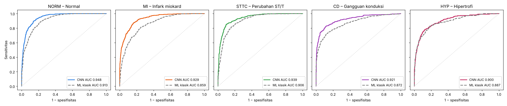
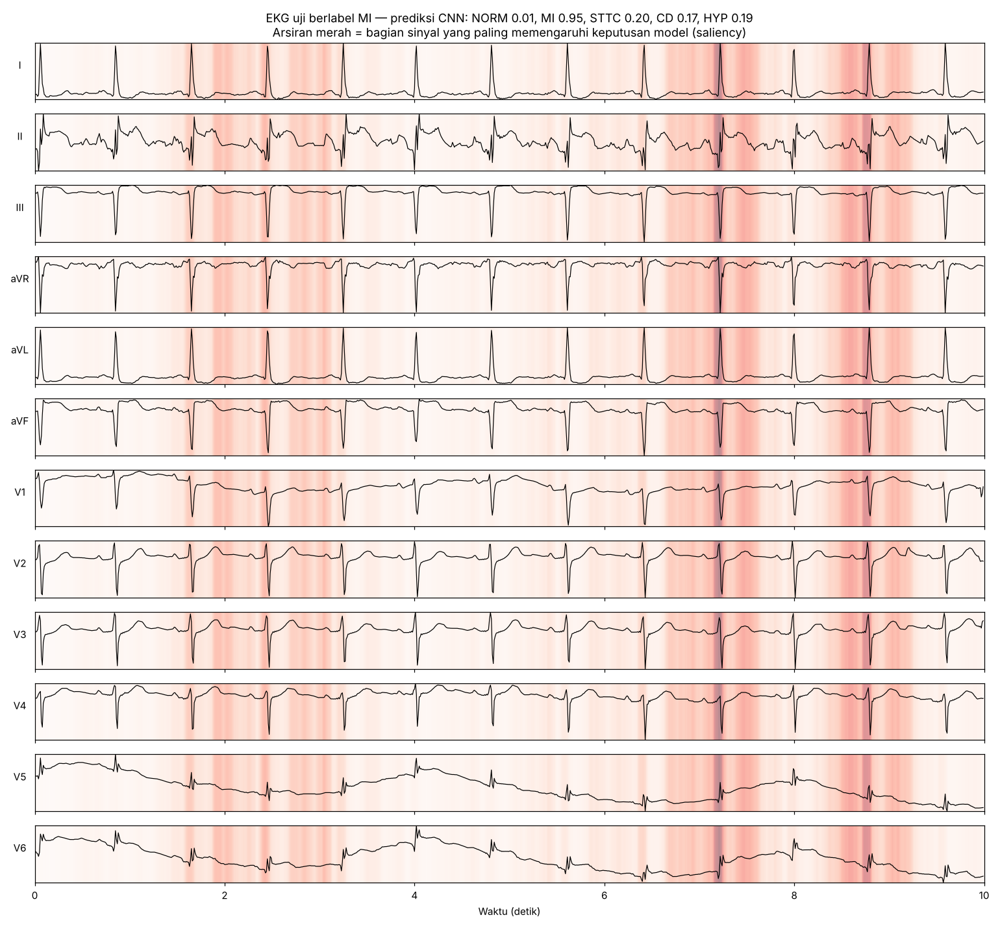

# Klasifikasi EKG 12 Sadapan: Machine Learning vs Deep Learning

Perbandingan model *machine learning* klasik (fitur buatan tangan + *gradient boosting*) dan *deep learning* (1D ResNet CNN) untuk mengklasifikasikan EKG 12 sadapan ke 5 kelompok diagnosis pada dataset **PTB-XL**.

Proyek pendamping makalah *"Pemanfaatan Machine Learning, Deep Learning, dan Large Language Model dalam Interpretasi Elektrokardiogram"* — Muhammad Affan Hassya Purnomo, FK UNS.

> Model ini untuk pembelajaran, **bukan** alat diagnosis klinis.

## Hasil (data uji, fold 10, n = 2.158 EKG)

| Kelas | Arti | AUC ML klasik | AUC CNN | Sensitivitas CNN | Spesifisitas CNN | PPV CNN |
|---|---|---|---|---|---|---|
| NORM | EKG normal | 0,913 | **0,948** | 92% | 83% | 81% |
| MI | Infark miokard | 0,859 | **0,929** | 87% | 83% | 64% |
| STTC | Perubahan ST/T | 0,906 | **0,939** | 88% | 84% | 64% |
| CD | Gangguan konduksi | 0,872 | **0,921** | 83% | 87% | 65% |
| HYP | Hipertrofi | 0,887 | **0,900** | 81% | 82% | 39% |
| **Macro** | | **0,887** | **0,927** | | | |

Sensitivitas/spesifisitas CNN dihitung pada ambang Youden yang dipilih dari set validasi (fold 9).



**Saliency** — bagian sinyal yang paling memengaruhi prediksi MI (probabilitas 0,95):



### Temuan utama
- CNN unggul di semua kelas; selisih terbesar pada **MI** (0,86 → 0,93), sesuai dengan kemampuan *deep learning* menangkap pola morfologi yang sulit dirumuskan sebagai fitur manual.
- **HYP** punya PPV hanya 39% meski AUC 0,90 karena prevalensinya rendah (12%) — AUC tinggi tidak otomatis berarti nilai prediksi positif tinggi.
- Catatan: model ML klasik dilatih pada fold 1–9, sedangkan CNN pada fold 1–8 (fold 9 untuk validasi), sehingga keunggulan CNN sedikit diremehkan.

## Dataset

[PTB-XL v1.0.3](https://physionet.org/content/ptb-xl/1.0.3/) (PhysioNet, lisensi CC BY 4.0): 21.799 EKG 12 sadapan, 10 detik, dari 18.869 pasien. Dipakai versi 100 Hz; 21.388 rekaman yang memiliki label diagnostik. Pembagian data mengikuti fold standar (1–8 latih, 9 validasi, 10 uji).

Dataset **tidak** disertakan di repo ini; unduh dengan perintah di bawah.

## Model

| | ML klasik | Deep learning |
|---|---|---|
| Input | 174 fitur: statistik amplitudo, daya spektral 4 pita, laju jantung & variabilitas RR, usia, jenis kelamin | Sinyal mentah 12 × 1000 sampel |
| Model | `HistGradientBoostingClassifier`, satu per kelas | 1D ResNet, 6 blok residual, ±1 juta parameter |
| Pelatihan | — | AdamW + one-cycle LR, 20 epoch, augmentasi (skala, noise, geser waktu) |

## Cara menjalankan

**Cara termudah:** buka [`notebook/klasifikasi_ekg_ptbxl.ipynb`](notebook/klasifikasi_ekg_ptbxl.ipynb) di Google Colab, pilih runtime GPU, lalu *Run all*.

**Lokal:**

```bash
pip install -r requirements.txt
mkdir -p data && cd data
wget -O ptbxl.zip https://physionet-open.s3.amazonaws.com/ptb-xl/ptb-xl-1.0.3.zip
unzip -q ptbxl.zip '*/records100/*' '*/ptbxl_database.csv' '*/scp_statements.csv' -d raw && rm ptbxl.zip
cd ..
python src/prep.py       # -> data/ptbxl100.npz
python src/train_ml.py   # baseline ML klasik
python src/train_dl.py   # CNN (±30 menit di CPU 2 core, beberapa menit di GPU)
python src/evaluate.py   # grafik & metrik -> hasil/
```

Bobot model terlatih tersedia di `model/resnet1d_best.pt` (normalisasi per sadapan di `model/norm.npz`).

## Struktur

```
src/        skrip preprocessing, pelatihan, evaluasi
notebook/   notebook lengkap siap-Colab (penjelasan Bahasa Indonesia)
model/      bobot CNN terlatih + parameter normalisasi
hasil/      kurva ROC, saliency, kurva pelatihan, metrik JSON, log
```

## Referensi

- Wagner P, Strodthoff N, Bousseljot RD, dkk. PTB-XL, a large publicly available electrocardiography dataset. *Sci Data*. 2020;7:154. [doi:10.1038/s41597-020-0495-6](https://doi.org/10.1038/s41597-020-0495-6)
- Goldberger AL, dkk. PhysioBank, PhysioToolkit, and PhysioNet. *Circulation*. 2000;101(23):e215–e220.
- Hannun AY, dkk. Cardiologist-level arrhythmia detection and classification in ambulatory electrocardiograms using a deep neural network. *Nat Med*. 2019;25:65–69. [doi:10.1038/s41591-018-0268-3](https://doi.org/10.1038/s41591-018-0268-3)
- Ribeiro AH, dkk. Automatic diagnosis of the 12-lead ECG using a deep neural network. *Nat Commun*. 2020;11:1760. [doi:10.1038/s41467-020-15432-4](https://doi.org/10.1038/s41467-020-15432-4)
