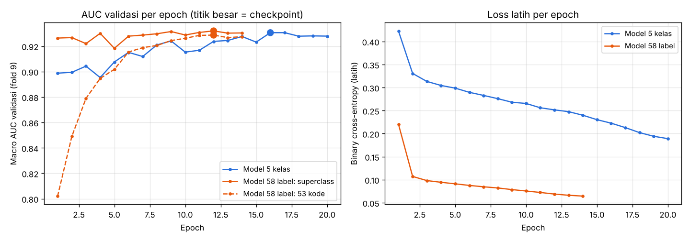

# Dokumentasi Pelatihan Model

Dokumen ini menjelaskan cara kedua model di repo ini dilatih dari dataset PTB-XL, dari unduhan data sampai bobot akhir. Versi naratifnya ada di makalah ([`makalah_ai_ekg.pdf`](makalah_ai_ekg.pdf), BAB IV–V).

| Model | Berkas | Keluaran | Macro AUC uji |
|---|---|---|---|
| Baseline ML klasik | — (tidak disimpan) | 5 superclass | 0,887 |
| 1D ResNet 5 kelas | `model/resnet1d_best.pt` | 5 superclass | 0,927 |
| 1D ResNet 58 label | `model/resnet1d_full.pt` + `model/labels.json` | 5 superclass + 53 kode SCP | 0,926 (superclass) · 0,920 (kode) |

## 1. Dataset: PTB-XL v1.0.3

- **Sumber:** [PhysioNet](https://physionet.org/content/ptb-xl/1.0.3/), lisensi CC BY 4.0 ([Wagner dkk., 2020](https://doi.org/10.1038/s41597-020-0495-6)).
- **Isi:** 21.799 EKG 12 sadapan × 10 detik dari 18.869 pasien, perangkat Schiller AG. Tersedia 500 Hz dan **100 Hz (yang dipakai)**.
- **Label:** 71 kode SCP-ECG (diagnostik, bentuk, irama) dari hingga 2 kardiolog; 74,3% rekaman divalidasi manusia.
- **Dipakai:** 21.388 rekaman (18.617 pasien) yang punya ≥ 1 kode diagnostik; 411 rekaman tanpa kode diagnostik dibuang.
- **Demografi:** usia median 61 tahun (IQR 50–72), 51,9% laki-laki.
- **Multi-label:** 16.244 EKG berlabel 1 superclass, 4.068 berlabel 2, 919 berlabel 3, 157 berlabel 4.

### Pembagian data

Memakai `strat_fold` bawaan PTB-XL: fold bertingkat per pasien, jadi satu pasien tidak pernah muncul di dua set.

| Superclass | Latih (fold 1–8) | Validasi (fold 9) | Uji (fold 10) | Prevalensi |
|---|---|---|---|---|
| NORM — EKG normal | 7.596 | 955 | 963 | 44,5% |
| MI — infark miokard | 4.379 | 540 | 550 | 25,6% |
| STTC — perubahan ST/T | 4.186 | 528 | 521 | 24,5% |
| CD — gangguan konduksi | 3.907 | 495 | 496 | 22,9% |
| HYP — hipertrofi | 2.119 | 268 | 262 | 12,4% |
| **Rekaman** | **17.084** | **2.146** | **2.158** | |

Validasi dipakai untuk memilih checkpoint dan ambang. Uji hanya dipakai sekali untuk angka akhir.

## 2. Pra-pemrosesan (`src/prep.py`)

1. Baca tiap rekaman 100 Hz dengan `wfdb.rdsamp` → matriks 1.000 × 12 dalam mV (urutan I, II, III, aVR, aVL, aVF, V1–V6).
2. Urai `scp_codes`; petakan kode diagnostik (`diagnostic == 1`) ke `diagnostic_class` dari `scp_statements.csv` → vektor 5 superclass.
3. Simpan ke `data/ptbxl100.npz` (`X`, `Y`, `fold`, `age`, `sex`, `ecg_id`).
4. Saat pelatihan: normalisasi z-score **per sadapan** dengan µ dan σ dari data latih saja (`model/norm.npz`; σ ekstremitas 0,14–0,16 mV, prekordial 0,23–0,33 mV), lalu transpos ke 12 × 1.000.
5. Khusus model 58 label: median tiap sadapan dikurangkan dulu (buang offset DC). Pada PTB-XL langkah ini tidak mengubah AUC (0,9275 → 0,9273), tetapi penting untuk data Holter.

## 3. Baseline ML klasik (`src/train_ml.py`)

174 fitur buatan tangan per EKG:

| Kelompok | Fitur | Jumlah |
|---|---|---|
| Statistik amplitudo per sadapan | rerata, SD, min, maks, puncak-ke-puncak, skewness, kurtosis, persentil 5 & 95, rerata \|selisih\| | 10 × 12 = 120 |
| Daya spektral per sadapan (Welch) | log daya 0,5–3 · 3–8 · 8–15 · 15–40 Hz | 4 × 12 = 48 |
| Irama (puncak R sadapan II) | frekuensi jantung, SD RR, CV RR, jumlah puncak | 4 |
| Demografi | usia, jenis kelamin | 2 |

Model: `HistGradientBoostingClassifier` (400 iterasi, learning rate 0,05), satu per superclass. Dilatih pada fold 1–9, diuji pada fold 10.

## 4. Arsitektur 1D ResNet (`src/train_dl.py`, kelas `ResNet1D`)

| Lapisan | Operasi | Keluaran | Parameter |
|---|---|---|---|
| Masukan | 12 sadapan × 1.000 sampel | 12 × 1.000 | — |
| Stem | Conv1D 64, k15, s2 → BN → ReLU → MaxPool 3/2 | 64 × 250 | 11.648 |
| Blok 1–2 | 2 × (Conv1D k7 → BN → ReLU) + identitas | 64 × 250 | 2 × 57.600 |
| Blok 3 | stride 2, 128 filter, pintas Conv 1×1 | 128 × 125 | 180.992 |
| Blok 4 | 128 filter | 128 × 125 | 229.888 |
| Blok 5 | stride 2, pintas Conv 1×1 | 128 × 63 | 246.528 |
| Blok 6 | 128 filter | 128 × 63 | 229.888 |
| Pooling | rerata ⊕ maksimum global | 256 | — |
| Kepala | Dropout 0,3 → Linear → sigmoid | 5 / 58 | 1.285 / 14.906 |
| **Total** | | | **1.015.429 / 1.029.050** |

Keluaran sigmoid per label (bukan softmax) karena satu EKG bisa positif untuk beberapa label.

## 5. Prosedur pelatihan

Loss: binary cross-entropy dirata-rata atas semua label (`BCEWithLogitsLoss`).

| Hiperparameter | Model 5 kelas (`train_dl.py`) | Model 58 label (`train_full.py`) |
|---|---|---|
| Inisialisasi | acak, seed 0 | backbone + 5 baris kepala dari model 5 kelas |
| Optimizer | AdamW, weight decay 0,01 | AdamW, weight decay 0,01 |
| Laju belajar | one-cycle, puncak 3e-3 | one-cycle, puncak 2e-3 |
| Batch | 64 | 64 |
| Epoch | 20 | 14 |
| Checkpoint | AUC makro validasi tertinggi (epoch 16) | AUC superclass + kode tertinggi (epoch 12) |
| Perangkat · waktu | CPU 2 thread · ±85 s/epoch | CPU 2 thread · ±95 s/epoch |

Augmentasi (acak per batch): skala amplitudo × N(1; 0,1), derau Gauss σ = 0,02 (satuan ternormalisasi), geser waktu melingkar ±50 sampel (±0,5 s).

### Label model 58 label

Semua kode SCP dengan ≥ 50 rekaman di antara 21.388 rekaman, kecuali `NORM` (sudah superclass): 53 kode. Sebuah kode positif bila tercantum di `scp_codes`, berapa pun tingkat keyakinannya. Kode < 50 contoh (flutter atrium, blok AV 2/3, SVT, dll.) tidak dilatih dan ditangani `src/measure.py`.

## 6. Kurva pelatihan



- **5 kelas:** AUC validasi 0,899 (epoch 1) → puncak 0,931 (epoch 16), lalu stabil di ±0,928; loss latih 0,423 → 0,189. AUC validasi tidak turun selama loss latih menurun, jadi overfitting di akhir pelatihan paling banter ringan.
- **58 label:** AUC superclass sudah 0,926 di epoch 1 (hasil transfer). AUC 53 kode naik 0,802 → 0,929 (epoch 12), lalu turun sedikit. Loss-nya lebih kecil daripada model 5 kelas karena dirata-rata atas 58 label yang sebagian besar negatif.

Data mentahnya: `hasil/res_dl.json` (5 kelas) dan `hasil/full_res.json` (58 label, kunci `history`).

## 7. Evaluasi dan ambang

- **AUC ROC** per label dan macro AUC pada fold 10. AUC tidak dipengaruhi prevalensi.
- **Ambang** dipilih di fold 9:
  - superclass → indeks Youden (sensitivitas + spesifisitas − 1 maksimum);
  - kode rinci → F1 maksimum, **minimal 0,10** (`src/finalize_full.py`). Tanpa batas ini, kode jarang mendapat ambang 0,02–0,04 dan memicu positif palsu.
- Sensitivitas, spesifisitas, dan PPV di fold 10 dengan ambang tersebut ada di `model/labels.json` (kunci `metrics`).
- **Saliency:** gradien probabilitas terhadap masukan (`src/evaluate.py`, `hasil/contoh_mi_saliency.png`).

## 8. Reproduksi dari nol

```bash
pip install -r requirements.txt
mkdir -p data && cd data
wget -O ptbxl.zip https://physionet-open.s3.amazonaws.com/ptb-xl/ptb-xl-1.0.3.zip   # ±1,8 GB
unzip -q ptbxl.zip '*/records100/*' '*/ptbxl_database.csv' '*/scp_statements.csv' -d raw && rm ptbxl.zip
cd ..
python src/prep.py            # → data/ptbxl100.npz (±2 menit)
python src/train_ml.py        # baseline ML klasik → hasil/res_ml.json
python src/train_dl.py        # 1D ResNet 5 kelas → model/resnet1d_best.pt, model/norm.npz (±30 menit CPU)
python src/evaluate.py        # ROC, saliency, kurva → hasil/
python src/train_full.py      # model 58 label → model/resnet1d_full.pt, hasil/full_res.json (±25 menit CPU)
python src/finalize_full.py   # ambang minimum + metrik → model/labels.json
```

Di Google Colab dengan GPU, gunakan `notebook/klasifikasi_ekg_ptbxl.ipynb` (model 5 kelas, beberapa menit).

Catatan reproduktibilitas: seed 0 dipakai untuk PyTorch dan NumPy. Hasil di mesin lain bisa berbeda sedikit (±0,005 AUC) karena perbedaan pustaka dan urutan operasi paralel.
